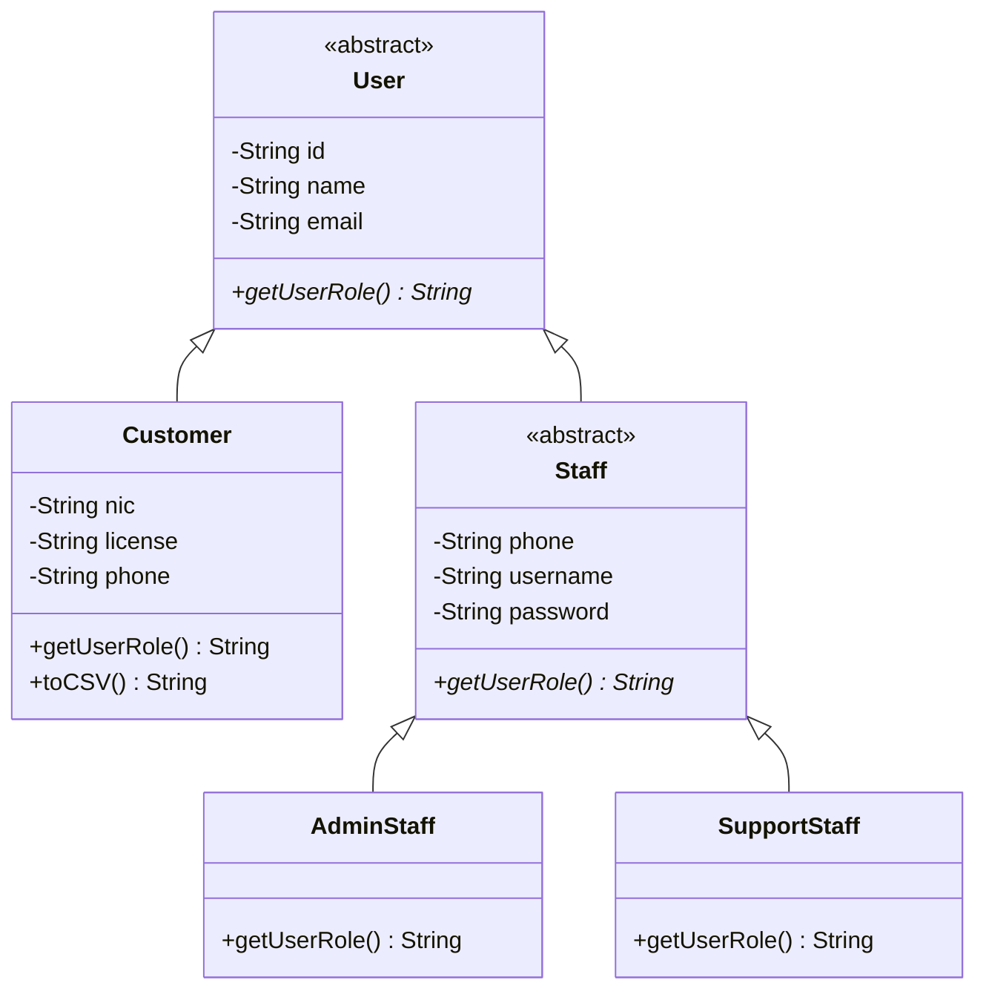

# Component Documentation: User Management

* **🎓 Student Identifier:** Student 1
* **🆔 University Registration No.:** IT25100142
* **🌿 Dedicated Git Branch:** `IT25100142---User-Management`

---

## 1. Subsystem Overview & Purpose
The **User Management** component forms the security, authentication, and user registry backbone of the DriveAway Vehicle Rental platform. It handles:
* Customer and staff account registration workflows.
* Secure session-based authentication and lifecycle controls (managed via [UserAuthController.java](../src/main/java/com/sliit/vehiclerentalsystem01/user/controller/UserAuthController.java)).
* User role differentiation (Customers vs. Support Staff vs. Administrators).
* Profile management (such as updating NIC, phone numbers, and driver's license numbers).
* System access request auditing to onboard new staff.

---

## 2. Component Directory & File Mapping
This component's responsibilities are divided across standard Spring Boot MVC tiers:

* **Entities (Domain Entities):**
  * [User.java](../src/main/java/com/sliit/vehiclerentalsystem01/user/entity/User.java): Abstract base class containing credentials, identity fields, and dynamic role indicators.
  * [Customer.java](../src/main/java/com/sliit/vehiclerentalsystem01/user/entity/Customer.java): Inherits from `User`, adding customer-specific license, nic, and phone details.
  * [Staff.java](../src/main/java/com/sliit/vehiclerentalsystem01/user/entity/Staff.java): Abstract base class representing operating team members.
  * [AdminStaff.java](../src/main/java/com/sliit/vehiclerentalsystem01/user/entity/AdminStaff.java): Concrete administrator subclass with user directory moderation privileges.
  * [SupportStaff.java](../src/main/java/com/sliit/vehiclerentalsystem01/user/entity/SupportStaff.java): Concrete support/maintenance representative subclass.
* **Repositories (Data Access Layer):**
  * [UserRepository.java](../src/main/java/com/sliit/vehiclerentalsystem01/user/repository/UserRepository.java): Manages file storage serialization and CSV line parsing of user records.
* **Services (Business Logic):**
  * [UserService.java](../src/main/java/com/sliit/vehiclerentalsystem01/user/service/UserService.java): Base user operations interface.
  * [UserServiceImpl.java](../src/main/java/com/sliit/vehiclerentalsystem01/user/service/UserServiceImpl.java): Coordinates authentication logic, customer profile updates, password matching, and registration flows. User rows are read and written via `UserRepository`; there is **no automatic seeding** of `data/users.txt` in this service.
  * [MasterAdminPendingService.java](../src/main/java/com/sliit/vehiclerentalsystem01/user/service/MasterAdminPendingService.java): Onboards and approves new staff access request cards.
* **Controllers (Request Routers):**
  * [UserAuthController.java](../src/main/java/com/sliit/vehiclerentalsystem01/user/controller/UserAuthController.java): Manages credentials verification, logins, registration forms, and session lifecycles.
  * [UserController.java](../src/main/java/com/sliit/vehiclerentalsystem01/user/controller/UserController.java): Manages profile details and customer/staff account editors.
  * [CustomerAdminController.java](../src/main/java/com/sliit/vehiclerentalsystem01/user/controller/CustomerAdminController.java): Admin panel listing all customer records.
  * [CustomerPortalController.java](../src/main/java/com/sliit/vehiclerentalsystem01/user/controller/CustomerPortalController.java): Customer dashboard panel route mapping.
  * [StaffAdminController.java](../src/main/java/com/sliit/vehiclerentalsystem01/user/controller/StaffAdminController.java): Admin panel listing and creating new staff members.
  * [UserAdminHomeController.java](../src/main/java/com/sliit/vehiclerentalsystem01/user/controller/UserAdminHomeController.java): Root admin path dashboard routers.
  * [UserManagementController.java](../src/main/java/com/sliit/vehiclerentalsystem01/user/controller/UserManagementController.java): Admin direct REST CRUD APIs for user records.
  * [MasterConsoleController.java](../src/main/java/com/sliit/vehiclerentalsystem01/user/controller/MasterConsoleController.java): Master-admin console routes (privileged operations as implemented in code).
* **Thymeleaf HTML Templates:**
  * `auth/register.html`: Customer account registration form.
  * `user/login.html`: Unified customer login form.
  * `user/staff-login.html`: Administrative staff login form.
  * `user/customer-dashboard.html`: Customer home dashboard.
  * `user/staff-dashboard.html`: Front desk team operations workspace.
  * `user/admin-dashboard.html`: High-level administrator metrics console.
  * `user/customer-directory.html`: Registered customers search table.
  * `user/staff-directory.html`: Operating team directory panel.
  * `user/edit-customer.html`: Customer profile editor.
  * `user/edit-staff.html`: Staff details modifier.
  * `user/master-console.html`: System diagnostics layout.

---

## 3. Academic OOP Rubric Implementation

### A. Abstraction
Defines [User.java](../src/main/java/com/sliit/vehiclerentalsystem01/user/entity/User.java) as `public abstract class User` to outline a uniform credential validation interface. Subclasses override `getUserRole()` dynamically:
```java
public abstract class User {
    private String id;
    private String name;
    private String email;

    public abstract String getUserRole();
}
```

### B. Encapsulation
Restricts account changes by keeping all state variables `private`. State is manipulated safely using normalization and validation guards inside setters and services (e.g., verifying phone and email formats):
```java
public void setEmail(String email) {
    if (email == null || !email.contains("@")) {
        throw new IllegalArgumentException("Invalid email format");
    }
    this.email = email.trim();
}
```

### C. Inheritance
A clean, modular inheritance tree separates access roles and profile details:



### D. Polymorphism
Used in [UserRepository.java](../src/main/java/com/sliit/vehiclerentalsystem01/user/repository/UserRepository.java) to dynamically deserialize various polymorphic classes from a single file by checking column counts:
```java
private User parseLine(String line) {
    String[] a = line.split(",", -1);
    if (a.length == 8) {
        Customer c = Customer.fromCSV(line);
        if (c != null) return c; // Returns concrete Customer
    }
    if (a.length == 7) {
        return parseStaffCsv(a); // Returns AdminStaff or SupportStaff subclass
    }
    throw new IllegalArgumentException("Invalid user record: " + line);
}
```

---

## 4. Flat-File Persistence Schema (`data/users.txt`)
User records are stored in a comma-delimited format inside `data/users.txt`. Field length separates Customers from Staff:
* **Customer Record (8 fields):**
  `id,name,email,username,password,nic,license,phone`
* **Staff Record (7 fields):**
  `id,name,email,phone,username,password,role` *(role is ADMIN or SUPPORT)*

### 🛡️ Concurrency Controls & Thread-Safety Model
Because credentials and profiles are queried dynamically during web logins and sessions, [UserRepository.java](../src/main/java/com/sliit/vehiclerentalsystem01/user/repository/UserRepository.java) coordinates user operations via a `ReentrantReadWriteLock` to eliminate concurrency issues:
* **Atomic CSV & Pipe Parsing Operations:** The parsing logic (including legacy pipe-separated fields or modern comma-separated rows) runs entirely within locked critical sections. When `saveUser()` or `deleteUserById()` is executed, the repository acquires an exclusive `WriteLock`. This guarantees that the read-modify-write cycle is completely atomic, blocking concurrent requests and preventing data corruption or race conditions while the underlying text file is parsed, mutated in memory, and safely serialized back to disk.
* **Concurrent Authentications:** Standard logins and session verification calls take a shared `ReadLock`. This permits massive multi-user, parallel read throughput, enabling high-throughput concurrent auth requests without thread blocking or latency.
* **Decoupled Architecture (Single Responsibility Principle):** The service layer ([UserServiceImpl.java](../src/main/java/com/sliit/vehiclerentalsystem01/user/service/UserServiceImpl.java)) focuses strictly on business validation (e.g., verifying unique usernames, formatting licenses, matching hashed passwords). It is completely decoupled from raw file I/O operations, stream handling, and parsing mechanics. This division of labor respects the Single Responsibility Principle (SRP), keeping business-level services fully independent of storage layer structures.
* **Fault-Tolerant Skipping & Robust Logging:** If the parser encounters a malformed user record, index misalignment, or invalid line structure, the repository utilizes localized try-catch blocks to gracefully intercept `IllegalArgumentException` bounds. It skips the corrupted line, logs a descriptive warning via the SLF4J logging framework, and continues loading remaining valid accounts safely, preventing HTTP 500 crashes and preserving system availability.

---

## 5. Component Workflows

### A. Authentication Sequence
```text
[Browser Login Form] ──(HTTP POST /login)──> [UserAuthController]
                                                    │
                                         (validate login credentials)
                                                    ▼
    [UserRepository] <──(query username)── [UserServiceImpl]
            │                                       │
     (instantiate subclass)                         │
            ▼                                       ▼
  (validate plain/hash matches) ──(Success)──> [Create Session Variables]
                                                    │
                                         (redirect to role-specific dashboard)
```

---

## 6. Verification and Integration
The component's authentication rules, registration pipelines, and user roles are verified by:
* Manual end-to-end integration tests using role-specific routes (`/login`, `/staff-login`, `/register`).
* Session boundaries maintained by security rules and globally accessible session constants under `com.sliit.vehiclerentalsystem01.core.security`.
