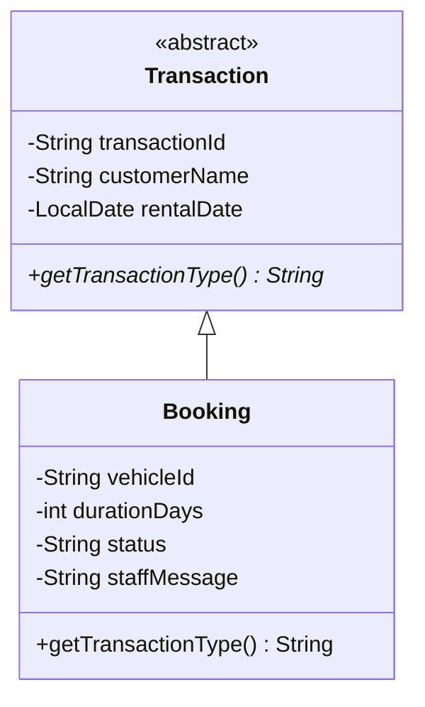

# Component Documentation: Reservations & Bookings

* **🎓 Student Identifier:** Student 2
* **🆔 University Registration No.:** IT25100445
* **🌿 Dedicated Git Branch:** `IT25100445---Reservations-&-Bookings`

---

## 1. Subsystem Overview & Purpose
The **Reservations & Bookings** component coordinates all transactional operations linking customer profiles to fleet inventory vehicles. It handles:
* Managing dynamic multi-step booking schedules.
* Calculating rental durations in days.
* Preventing vehicle double bookings.
* Enforcing business validations (e.g. preventing rentals in the past or date mismatch).
* Managing active rental status states (`CONFIRMED`, `CANCELLATION_REQUESTED`, `CANCELLED`, `COMPLETED`).
* Enabling front desk staff to approve, modify, or reject reservation bookings.

---

## 2. Component Directory & File Mapping
This component's responsibilities are divided across the standard Spring Boot MVC tiers:

* **Entities (Domain Entities):**
  * [Transaction.java](../src/main/java/com/sliit/vehiclerentalsystem01/reservation/entity/Transaction.java): Polymorphic abstract base class for monetary transactions. It defines common identifiers and the abstract contract `getTransactionType()`.
  * [Booking.java](../src/main/java/com/sliit/vehiclerentalsystem01/reservation/entity/Booking.java): Concrete subclass representing vehicle rental schedules. It captures parameters like vehicle ID, duration in days, rental date, status, and staff response notes.
* **Repositories (Data Access Layer):**
  * [ReservationRepository.java](../src/main/java/com/sliit/vehiclerentalsystem01/reservation/repository/ReservationRepository.java): Coordinates CSV file database operations, parsing, and serialization of booking transactional data.
* **Services (Business Logic):**
  * [ReservationService.java](../src/main/java/com/sliit/vehiclerentalsystem01/reservation/service/ReservationService.java): Coordinates rental schedules, calendars, and transaction limits.
  * [ReservationServiceImpl.java](../src/main/java/com/sliit/vehiclerentalsystem01/reservation/service/ReservationServiceImpl.java): Implements business validations, calendar conflict validations, and active reservation audits.
* **Controllers (Request Routers):**
  * [BookingController.java](../src/main/java/com/sliit/vehiclerentalsystem01/reservation/controller/BookingController.java): Coordinates customer booking submissions and confirmations.
  * [ReservationAdminController.java](../src/main/java/com/sliit/vehiclerentalsystem01/reservation/controller/ReservationAdminController.java): Staff console controller managing pending bookings, updates, cancellations, and reviews.
* **Thymeleaf HTML Templates (`templates/booking` folder):**
  * `booking/booking-admin-form.html`: Admin booking modification panel.
  * `booking/booking-dashboard.html`: Staff central reservations dashboard.
  * `booking/booking-detail.html`: Detailed reservation metadata review card.
  * `booking/booking-form.html`: Multi-step customer reservation wizard form.
  * `booking/booking-list.html`: Central booking index view list.
  * `booking/cancel-booking.html`: Customer reservation cancellation form.
  * `booking/edit-booking.html`: Customer booking date/duration update wizard.
  * `booking/my-bookings.html`: Customer's personal reservations listing panel.
  * `booking/search-booking.html`: Interactive reservations query panel.
  * `booking/view-all-bookings.html`: Support/Admin total reservations overview.

---

## 3. Academic OOP Rubric Implementation

### A. Abstraction
Declares [Transaction.java](../src/main/java/com/sliit/vehiclerentalsystem01/reservation/entity/Transaction.java) as `public abstract class Transaction` to enforce uniform logging metadata across all financial transactions, mandating `getTransactionType()`:
```java
public abstract class Transaction {
    private String transactionId;
    private String customerName;
    private LocalDate rentalDate;

    public abstract String getTransactionType();
}
```

### B. Encapsulation
Encapsulates booking validation within [ReservationServiceImpl.java](../src/main/java/com/sliit/vehiclerentalsystem01/reservation/service/ReservationServiceImpl.java) to prevent double bookings. Setters in [Booking.java](../src/main/java/com/sliit/vehiclerentalsystem01/reservation/entity/Booking.java) validate input data (e.g. durations must be greater than zero):
```java
public void setDurationDays(int durationDays) {
    if (durationDays <= 0) {
        throw new IllegalArgumentException("Rental duration must be at least 1 day");
    }
    this.durationDays = durationDays;
}
```

### C. Inheritance
The booking subsystem features a clean parent-child relationship:



### D. Polymorphism
Used in templates when rendering logs polymorphic displays by invoking `getTransactionType()`, and when serializing transaction lists dynamically to flat-files.

---

## 4. Flat-File Persistence Schema (`data/bookings.txt`)
Booking data is parsed and serialized in a comma-delimited format inside `data/bookings.txt`:
* **Booking Record Schema:**
  `transactionId,customerName,rentalDate,vehicleId,durationDays,status,staffMessage`
* **Sample Entry:**
  `TXN-001,customer,2026-05-20,VEH-101,5,CONFIRMED,Enjoy your ride!`

### 🛡️ Concurrency Controls & Thread-Safety Model
To avoid double booking (overbooking) under high concurrent checkout traffic (e.g. multiple clients attempting to reserve the exact same vehicle for overlapping dates simultaneously), [ReservationRepository.java](../src/main/java/com/sliit/vehiclerentalsystem01/reservation/repository/ReservationRepository.java) coordinates reservation operations via a `ReentrantReadWriteLock` to guarantee complete transactional safety:
* **Atomic Double-Booking Prevention & CSV/Pipe parsing:** When a booking is finalized, modified, or cancelled, the repository acquires an exclusive `WriteLock`. This serializes the read-modify-write cycle on the underlying database flat-file, guaranteeing that the parsing (supporting legacy pipe schedules and modern comma delimiters) and writing process is entirely atomic. This blocks concurrent threads from checking out the same vehicle for overlapping dates, eliminating critical race conditions during the crucial checkout phase.
* **Concurrent Calendar Queries:** Reading active reservations for catalog searches, availability checking, and scheduling lookups acquires a shared `ReadLock`. This allows swift parallel read access to booking records under high-throughput concurrent search traffic.
* **Decoupled Architecture (Single Responsibility Principle):** The service layer ([ReservationServiceImpl.java](../src/main/java/com/sliit/vehiclerentalsystem01/reservation/service/ReservationServiceImpl.java)) strictly manages calendar calculations, date validations (preventing past dates or duration anomalies), and availability business rules. By fully decoupling the service layer from direct file stream manipulation or delimiter splitting, the application enforces the Single Responsibility Principle, leaving all persistence details to the repository tier.
* **Fault-Tolerant Scanning & SLF4J Warnings:** If a single record within `bookings.txt` is incomplete, corrupted, or contains malformed numbers, the repository handles the parsing boundary exception gracefully. Rather than bubbling up as an HTTP 500 error, it logs a warning via the SLF4J interface and continues scanning the remaining rental entries, guaranteeing calendar system resilience.

---

## 5. Component Workflows

### A. Vehicle Reservation Validation Flow
```text
[Customer Selects Dates] ──(HTTP POST /book/confirm)──> [BookingController]
                                                                │
                                                     (check vehicle availability)
                                                                ▼
   [ReservationRepository] <──(query active bookings)── [ReservationServiceImpl]
            │                                                   │
    (checks dates overlaps)                                     │
            ▼                                                   ▼
  (availability: OK) ──(add reservation record)──> [Serialize Booking CSV line]
            │                                                   │
            └───────(Failure: overlap detected)───────> [Throw IllegalStateException]
```

---

## 6. Verification and Integration
The component is verified by:
* End-to-end integration with the vehicle catalog page and customer dashboard.
* Calendar date validations preventing past-date selections and verifying overlap logic against records managed in the flat-file backend.
