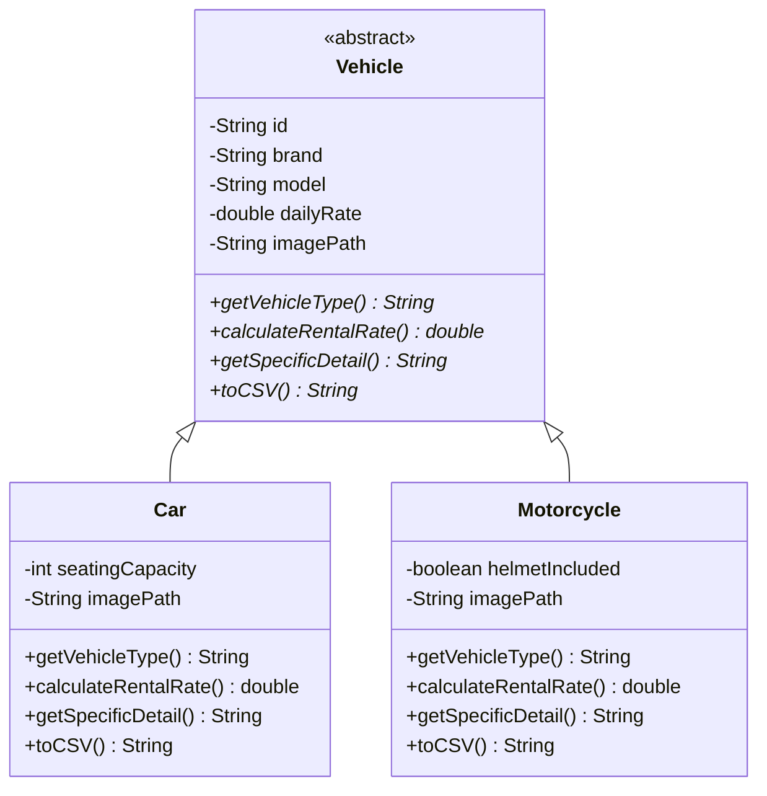

# Component Documentation: Vehicle Fleet Inventory

* **🎓 Student Identifier:** Student 3
* **🆔 University Registration No.:** IT24100879
* **🌿 Dedicated Git Branch:** `IT24100879---Vehicle-Fleet-Inventory`

---

## 1. Subsystem Overview & Purpose
The **Vehicle Fleet Inventory** component manages all physical assets of the rental platform. It handles:
* Modeling cars and motorcycles through a polymorphic entity structure.
* Calculating specific rental rates based on type-specific metrics (e.g. seating capacity or helmet rentals).
* Exposing a public vehicle browse panel with interactive search filters.
* Providing administrators with fleet inventory controls (add, edit, and delete options).
* Enforcing system safety validations, such as preventing the deletion of a vehicle that is currently under an active rental lease.

---

## 2. Component Directory & File Mapping
This component's responsibilities are divided across standard Spring Boot MVC tiers:

* **Entities (Domain Entities):**
  * [Vehicle.java](../src/main/java/com/sliit/vehiclerentalsystem01/vehicle/entity/Vehicle.java): Abstract base class defining common fields (`id`, `brand`, `model`, `dailyRate`, `imagePath`) and declaring abstract methods `getVehicleType()`, `calculateRentalRate()`, `getSpecificDetail()`, and `toCSV()`.
  * [Car.java](../src/main/java/com/sliit/vehiclerentalsystem01/vehicle/entity/Car.java): Concrete subclass representing cars, adding `seatingCapacity` encapsulation.
  * [Motorcycle.java](../src/main/java/com/sliit/vehiclerentalsystem01/vehicle/entity/Motorcycle.java): Concrete subclass representing motorcycles, adding a `helmetIncluded` flag.
* **Repositories (Data Access Layer):**
  * [VehicleRepository.java](../src/main/java/com/sliit/vehiclerentalsystem01/vehicle/repository/VehicleRepository.java): Manages CSV database operations and type serialization/deserialization for fleet records.
* **Services (Business Logic):**
  * [VehicleService.java](../src/main/java/com/sliit/vehiclerentalsystem01/vehicle/service/VehicleService.java): Core fleet registry interface.
  * [VehicleServiceImpl.java](../src/main/java/com/sliit/vehiclerentalsystem01/vehicle/service/VehicleServiceImpl.java): Implements brand query methods, catalog lookups, and deletion safety checks.
* **Controllers (Request Routers):**
  * [VehicleController.java](../src/main/java/com/sliit/vehiclerentalsystem01/vehicle/controller/VehicleController.java): Coordinates public catalogs browsing and admin-staff inventory control routes.
* **Thymeleaf HTML Templates (`templates/vehicle` folder):**
  * `vehicle/vehicle-browse.html`: Dynamic vehicle catalog display & search card view.
  * `vehicle/vehicle-dashboard.html`: Admin catalog overview and deletion panels view.
  * `vehicle/vehicle-form.html`: Admin add/edit vehicle details entry view.
  * `vehicle/vehicle-detail.html`: Polymorphic vehicle details inspection panel view.
  * `vehicle/vehicle-entity-form.html`: Subclass custom properties layout block view.
  * `vehicle/vehicle-list.html`: Inline fleet catalog lists view.
  * `vehicle/add-vehicle.html`: Admin new fleet registration console view.
  * `vehicle/edit-vehicle.html`: Admin edit existing vehicle specification console view.

---

## 3. Academic OOP Rubric Implementation

### A. Abstraction
Declares [Vehicle.java](../src/main/java/com/sliit/vehiclerentalsystem01/vehicle/entity/Vehicle.java) as `public abstract class Vehicle` to establish a uniform fleet interface. Subclasses implement specialized pricing and details contracts:
```java
public abstract class Vehicle {
    private String id;
    private String brand;
    private String model;
    private double dailyRate;
    private String imagePath;

    public abstract String getVehicleType();
    public abstract double calculateRentalRate();
    public abstract String getSpecificDetail();
    public abstract String toCSV();
}
```

### B. Encapsulation
Domain state attributes are declared `private`. Access is granted via getter/setter methods. State validation preserves domain rules:
```java
public void setDailyRate(double dailyRate) {
    if (dailyRate <= 0.0) {
        throw new IllegalArgumentException("Daily rate must be a positive number");
    }
    this.dailyRate = dailyRate;
}
```

### C. Inheritance
The vehicle module establishes an elegant, extensible type hierarchy:



### D. Polymorphism
Polymorphism is demonstrated through dynamic method overriding and dispatch:
* **Overridden Rate Calculations:** `Car.calculateRentalRate()` returns the base daily rate. `Motorcycle.calculateRentalRate()` applies a type-specific multiplier (see `Motorcycle.java`); helmet inclusion is reflected in `getSpecificDetail()`, not as a separate per-day surcharge in the current implementation.
* **Polymorphic CSV Serialization:** [VehicleRepository.java](../src/main/java/com/sliit/vehiclerentalsystem01/vehicle/repository/VehicleRepository.java) iterates over a list of `Vehicle` objects and writes each record by calling `toCSV()`. Dynamic dispatch executes the overridden `toCSV()` method in the correct subclass at runtime:
```java
public String toCSV() { // In Car.java
    return "Car," + getId() + "," + getBrand() + "," + getModel() + "," + getDailyRate() + "," + seatingCapacity + "," + getImagePath();
}
```

---

## 4. Flat-File Persistence Schema (`data/vehicles.txt`)
Fleet inventory records are stored in a comma-delimited format inside `data/vehicles.txt`. The first column acts as the **Polymorphic Type Discriminator**:
* **Car Record:**
  `Car,id,brand,model,dailyRate,seatingCapacity,imagePath`
* **Motorcycle Record:**
  `Motorcycle,id,brand,model,dailyRate,helmetIncluded,imagePath`

The trailing `imagePath` field may be empty; [VehicleRepository](../src/main/java/com/sliit/vehiclerentalsystem01/vehicle/repository/VehicleRepository.java) supplies a default when omitted so older rows remain loadable.

### 🛡️ Concurrency Controls & Thread-Safety Model
To preserve inventory accuracy and avoid database integrity issues when administrators add, modify, or retire vehicles while customers are actively checking out, [VehicleRepository.java](../src/main/java/com/sliit/vehiclerentalsystem01/vehicle/repository/VehicleRepository.java) implements a concurrency wrapper using `ReentrantReadWriteLock`:
* **Atomic Fleet Updates & Discriminator CSV/Pipe Parsing:** In fleet operations, adding, modifying, or deleting a vehicle record acquires an exclusive `WriteLock`. This serializes mutations on `data/vehicles.txt`. The entire CSV parsing flow (identifying polymorphic `Car` or `Motorcycle` discriminators, processing seating capacity, helmet fields, and resolving legacy pipe delimiters) runs securely under the Write Lock. This guarantees atomic read-modify-write transactions, preventing lost updates or file corruption.
* **Shared Catalog Access:** Customer browsing, searches, brand filtering, and vehicle specification displays acquire a shared `ReadLock`. This maximizes catalog load and filtering throughput, permitting concurrent access to vehicle listings under intense multi-user workloads without blockages.
* **Decoupled Architecture (Single Responsibility Principle):** The service layer ([VehicleServiceImpl.java](../src/main/java/com/sliit/vehiclerentalsystem01/vehicle/service/VehicleServiceImpl.java)) focuses strictly on business-tier validations (e.g., validating non-negative rates, implementing search queries, blocking active vehicle deletions). It remains completely isolated from CSV split limits, IO operations, and path resolutions, demonstrating solid compliance with the Single Responsibility Principle.
* **Fault-Tolerant Skipping & SLF4J Warnings:** If a vehicle database entry is malformed or corrupted (e.g., containing alphabetical daily rates or missing critical details columns), the repository's parser catches the error locally. It logs a warning via the SLF4J API and skips the malformed record, ensuring catalog list pages continue to load valid items smoothly.

---

## 5. Component Workflows

### A. Add Polymorphic Vehicle Sequence
```text
[Admin Selects Type] ──(Fills HTML Form)──> [VehicleController]
                                                    │
                                         (instantiates Car/Motorcycle)
                                                    ▼
    [VehicleRepository] <──(call save())──> [VehicleServiceImpl]
            │
    (serializes via toCSV())
            ▼
 [Appends polymorphic line] ──> [Save to vehicles.txt]
```

---

## 6. Verification and Integration
The component is verified by:
* Manual administrative catalog additions (using `/vehicles/add` and `/vehicles/edit`) checking that Cars and Motorcycles successfully render subclass-specific fields on the public browse cards and properly persist custom comma discriminatory rows.
