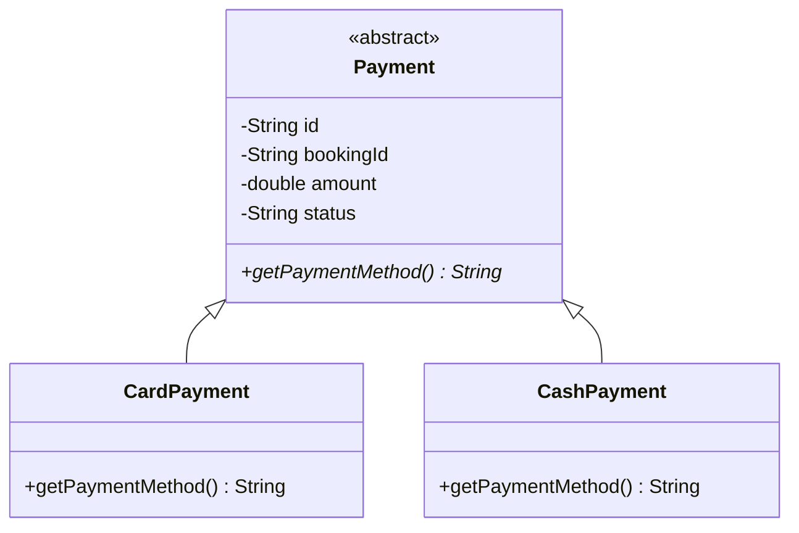

# Component Documentation: Payment & Billing

* **🎓 Student Identifier:** Student 4
* **🆔 University Registration No.:** IT25100385
* **🌿 Dedicated Git Branch:** `IT25100385---Payment-&-Billing`

---

## 1. Subsystem Overview & Purpose
The **Payment & Billing** component manages all financial workflows, invoicing, and transactional logs of the platform. It handles:
* Calculating total rental costs based on rental durations and vehicle daily rates.
* Supporting multiple payment options (Credit/Debit Card and Cash payments) through a polymorphic payment model hierarchy.
* Capturing payment data, including amount, transaction status, and booking identifiers.
* Auditing financial checkout logs through an administrative dashboard.
* Generating and displaying printable customer receipts and invoice sheets.

---

## 2. Component Directory & File Mapping
This component's responsibilities are divided across standard Spring Boot MVC tiers:

* **Entities (Domain Entities):**
  * [Payment.java](../src/main/java/com/sliit/vehiclerentalsystem01/payment/entity/Payment.java): Abstract base class defining common fields (`id`, `bookingId`, `amount`, `status`) and declaring abstract methods `getPaymentMethod()` and `getPaymentType()`.
  * [CardPayment.java](../src/main/java/com/sliit/vehiclerentalsystem01/payment/entity/CardPayment.java): Concrete subclass representing credit/debit card transactions.
  * [CashPayment.java](../src/main/java/com/sliit/vehiclerentalsystem01/payment/entity/CashPayment.java): Concrete subclass representing cash ledger entries.
  * [PaymentStatus.java](../src/main/java/com/sliit/vehiclerentalsystem01/payment/entity/PaymentStatus.java): Normalized status constants; [PaymentRepository](../src/main/java/com/sliit/vehiclerentalsystem01/payment/repository/PaymentRepository.java) normalizes the CSV status column through `PaymentStatus.fromString(...)` when loading rows.
* **Repositories (Data Access Layer):**
  * [PaymentRepository.java](../src/main/java/com/sliit/vehiclerentalsystem01/payment/repository/PaymentRepository.java): Manages file storage serialization, legacy pipe parsing, and CSV operations for card and cash payments.
* **Services (Business Logic):**
  * [PaymentService.java](../src/main/java/com/sliit/vehiclerentalsystem01/payment/service/PaymentService.java): Core billing calculation and ledger verification interface.
  * [PaymentServiceImpl.java](../src/main/java/com/sliit/vehiclerentalsystem01/payment/service/PaymentServiceImpl.java): Implements duration billing formulas, card parameters validation, and active status ledger controls.
* **Controllers (Request Routers):**
  * [PaymentController.java](../src/main/java/com/sliit/vehiclerentalsystem01/payment/controller/PaymentController.java): Coordinates card/cash payment forms, customer receipt page layouts, and the admin ledgers monitor dashboard.
* **Thymeleaf HTML Templates (`templates/payment` folder):**
  * `payment/process-payment.html`: Card details validator and billing payment form view.
  * `payment/customer-payment.html`: Customer-facing checkout gateway form.
  * `payment/customer-billing.html`: Invoice breakdown billing details printable format view.
  * `payment/payment-dashboard.html`: Admin checkout transactional records table view.
  * `payment/payment-detail.html`: Tenders ledgers details inspection card view.
  * `payment/edit-payment.html`: Update invoice status administrative control view.

---

## 3. Academic OOP Rubric Implementation

### A. Abstraction
Declares [Payment.java](../src/main/java/com/sliit/vehiclerentalsystem01/payment/entity/Payment.java) as `public abstract class Payment` to define a uniform interface for all monetary settlements, mandating the `getPaymentMethod()` contract:
```java
public abstract class Payment {
    private String id;
    private String bookingId;
    private double amount;
    private String status;

    public abstract String getPaymentMethod();
}
```

### B. Encapsulation
Keep transactional properties `private`. Setters validate data (e.g. checking that the invoice amount is positive) to preserve ledger integrity:
```java
public void setAmount(double amount) {
    if (amount < 0.0) {
        throw new IllegalArgumentException("Payment amount cannot be negative");
    }
    this.amount = amount;
}
```

### C. Inheritance
The payment module adopts a simple, modular class hierarchy:



### D. Polymorphism
Polymorphism is demonstrated by overriding the `getPaymentMethod()` method, which dynamically dispatches the correct payment type label at runtime:
* **Dynamic View Rendering:** In customer billing views, Thymeleaf displays the appropriate payment type dynamically by calling `payment.getPaymentMethod()`.
* **Polymorphic File Serialization:** [PaymentRepository.java](../src/main/java/com/sliit/vehiclerentalsystem01/payment/repository/PaymentRepository.java) processes list elements as base `Payment` objects, dynamically writing their subtype indicators (`CARD` or `CASH`) to the flat-file database.

---

## 4. Flat-File Persistence Schema (`data/payments.txt`)
Payment logs are serialized in a comma-delimited format inside `data/payments.txt`. The first column acts as the type discriminator:
* **Record Schema:**
  `CARD|CASH,id,bookingId,amount,status` (the fifth column is parsed into [PaymentStatus](../src/main/java/com/sliit/vehiclerentalsystem01/payment/entity/PaymentStatus.java) names such as `PAID`, `PENDING`, `VERIFYING`, `REFUNDED`, `FAILED`, with synonyms mapped by `fromString`.)
* **Sample Entries:**
  `CARD,PAY-001,TXN-101,250.0,PAID`
  `CASH,PAY-002,TXN-102,120.0,PENDING`

### 🛡️ Concurrency Controls & Thread-Safety Model
To safeguard financial transaction logs and ledger audits, [PaymentRepository.java](../src/main/java/com/sliit/vehiclerentalsystem01/payment/repository/PaymentRepository.java) manages ledger transactions via a concurrent `ReentrantReadWriteLock` structure:
* **Atomic Financial Logging & CSV/Pipe Ledger Parsing:** During checkout, invoice state updates (such as shifting cash statuses to `PAID`), or billing refunds, the repository locks database updates with an exclusive `WriteLock`. Under this lock, payment records are safely parsed (handling CARD/CASH polymorphic discriminators, parsing currency fields, and processing legacy pipe formats) and serialized back to `data/payments.txt`. This read-modify-write transactional atomicity prevents double checkouts, duplicate ledger entries, and dirty reads during peak transactional volumes.
* **Shared Ledger Access:** Loading payment metrics, generating financial statements, or accessing administrative audit charts acquires a shared `ReadLock`. This permits simultaneous, concurrent non-blocking reads across the support staff network.
* **Decoupled Architecture (Single Responsibility Principle):** The service layer ([PaymentServiceImpl.java](../src/main/java/com/sliit/vehiclerentalsystem01/payment/service/PaymentServiceImpl.java)) strictly manages invoice cost calculations, tax rate configurations, and payment card format validations. Keeping file channels and parsing arrays out of the service tier guarantees adherence to the Single Responsibility Principle, cleanly isolating business calculations from data storage systems.
* **Fault-Tolerant Skipping & SLF4J Warnings:** If a payment record is corrupt, incomplete, or contains illegal number parsing values (e.g. malformed currency strings), the parser intercepts the error locally. It records a warning in SLF4J and continues reading subsequent rows safely, keeping financial ledgers stable and avoiding HTTP 500 crashes.

---

## 5. Component Workflows

### A. Dynamic Billing Calculation Workflow
```text
[Customer clicks checkout] ──> [PaymentController]
                                       │
                          (calculates duration & total cost)
                                       ▼
    [VehicleService] <──(query daily rate)── [PaymentServiceImpl]
           │                                      │
    (returns rate)                                │
           ▼                                      ▼
  (total = rate * days) ──(confirm tender choice)──> [Save Card/Cash Payment subclass]
                                                           │
                                                [Save via PaymentRepository]
```

---

## 6. Verification and Integration
The component is verified by:
* End-to-end checkout and receipt generation routines.
* Invoicing ledger transitions testing (changing cash status from `PENDING` to `PAID` via the admin dashboard and checking the output in `data/payments.txt`).
