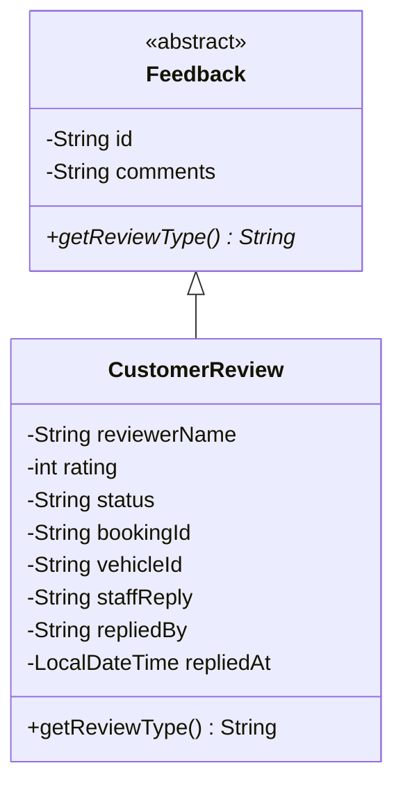

# Component Documentation: Customer Reviews

* **🎓 Student Identifier:** Student 5
* **🆔 University Registration No.:** IT25100565
* **🌿 Dedicated Git Branch:** `IT25100565--Customer-Reviews`

---

## 1. Subsystem Overview & Purpose
The **Customer Reviews** component manages customer feedback, star ratings, and staff moderation panels. It handles:
* Collecting customer star ratings and written reviews.
* Verifying ratings constraints (ensuring star values are between 1 and 5).
* Displaying vehicle feedback listings on rental catalogs.
* Providing a staff moderation console to approve or reject pending reviews.
* Enabling support staff to reply to customer comments, tracking the replier's username and response timestamp.

---

## 2. Component Directory & File Mapping
This component's responsibilities are divided across standard Spring Boot MVC tiers:

* **Entities (Domain Entities):**
  * [Feedback.java](../src/main/java/com/sliit/vehiclerentalsystem01/review/entity/Feedback.java): Abstract base class defining common metadata and declaring the abstract method `getReviewType()`.
  * [CustomerReview.java](../src/main/java/com/sliit/vehiclerentalsystem01/review/entity/CustomerReview.java): Concrete subclass representing reviews. It captures reviewer name, star rating (1-5), comments, approval status, and staff reply fields.
* **Repositories (Data Access Layer):**
  * [ReviewRepository.java](../src/main/java/com/sliit/vehiclerentalsystem01/review/repository/ReviewRepository.java): Coordinates CSV file operations, parsing, and serialization of rating comments.
* **Services (Business Logic):**
  * [ReviewService.java](../src/main/java/com/sliit/vehiclerentalsystem01/review/service/ReviewService.java): Coordinates moderation, approval states, and reply tracking contract.
  * [ReviewServiceImpl.java](../src/main/java/com/sliit/vehiclerentalsystem01/review/service/ReviewServiceImpl.java): Implements moderation transition rules, rating boundary controls, and staff reply trail tracking.
* **Controllers (Request Routers):**
  * [ReviewController.java](../src/main/java/com/sliit/vehiclerentalsystem01/review/controller/ReviewController.java): Coordinates review submissions, the star rating dashboard, and staff response editors.
* **Thymeleaf HTML Templates (`templates/review` folder):**
  * `review/customer-review-form.html`: Customer submit vehicle feedback rating view.
  * `review/customer-reviews-list.html`: Vehicle profile reviews list view.
  * `review/edit-review.html`: Add admin feedback reply form view.
  * `review/review-dashboard.html`: Staff reviews moderation and replies list view.
  * `review/review-detail.html`: Review comment and ratings inspect card view.

---

## 3. Academic OOP Rubric Implementation

### A. Abstraction
Declares [Feedback.java](../src/main/java/com/sliit/vehiclerentalsystem01/review/entity/Feedback.java) as `public abstract class Feedback` to establish a standard interface for comments and ratings, mandating the abstract `getReviewType()` method:
```java
public abstract class Feedback {
    private String id;
    private String comments;

    public abstract String getReviewType();
}
```

### B. Encapsulation
Star ratings are validated to ensure values remain within the valid [1 - 5] range:
```java
public void setRating(int rating) {
    if (rating < 1 || rating > 5) {
        throw new IllegalArgumentException("Star rating must be between 1 and 5");
    }
    this.rating = rating;
}
```

### C. Inheritance
The review module implements a standard class hierarchy:



### D. Polymorphism
Polymorphism is demonstrated through dynamic dispatch of `getReviewType()` and by dynamically rendering UI star sliders and average rating counters based on ratings scores at runtime.

---

## 4. Flat-File Persistence Schema (`data/reviews.txt`)
Reviews are serialized in a comma-delimited format inside `data/reviews.txt`:
* **Record Schema:**
  `reviewId,reviewerName,rating,comments,status,bookingId,vehicleId,staffReply,repliedBy,repliedAt`
* **Sample Entry:**
  `REV-001,customer,5,Smooth ride,APPROVED,TXN-101,VEH-101,Thank you!,support,2026-05-21T10:00:00`

### 🛡️ Concurrency Controls & Thread-Safety Model
To prevent data corruption or dirty reads when customers are writing feedback and support staff are replying or approving reviews in real-time, [ReviewRepository.java](../src/main/java/com/sliit/vehiclerentalsystem01/review/repository/ReviewRepository.java) leverages `ReentrantReadWriteLock` concurrency tools:
* **Shared Feedback Queries:** Fetching approved reviews to display on the vehicle browser grid takes a shared `ReadLock`, permitting non-blocking reads for catalog grids.
* **Atomic Moderation & Replies:** Submitting reviews, approving/rejecting a pending review, or posting staff replies takes an exclusive `WriteLock`, guaranteeing complete thread serialization during flat-file writes.
* **Decoupled Architecture (Single Responsibility Principle):** The service layer ([ReviewServiceImpl.java](../src/main/java/com/sliit/vehiclerentalsystem01/review/service/ReviewServiceImpl.java)) validates business boundaries (e.g., verifying that ratings are strictly between 1 and 5, auditing staff replies). It relies entirely on the repository layer to perform atomic flat-file writing, separating business validations from I/O processing.
* **Fault-Tolerant Scanning:** If a single line in `reviews.txt` is incomplete or malformed (e.g. invalid date formats), the repository skips it gracefully, logs a warning via SLF4J, and returns the remaining valid feedback stream.

---

## 5. Component Workflows

### A. Customer Feedback Submission Sequence
```text
[Customer Submits Star Rating] ──(HTTP POST /reviews)──> [ReviewController]
                                                                │
                                                     (validate rating bounds)
                                                                ▼
   [ReviewRepository] <──(call saveReview())── [ReviewServiceImpl]
            │
   (saves with PENDING state)
            ▼
 [Appends review CSV line] ──> [Save to reviews.txt]
```

---

## 6. Verification and Integration
The component is verified by:
* Testing review submissions on completed vehicle bookings, asserting that a customer cannot write a review without an active/completed booking.
* Validating moderation transitions via the review dashboard, checking that staff replies append and update the CSV record in `data/reviews.txt`.
