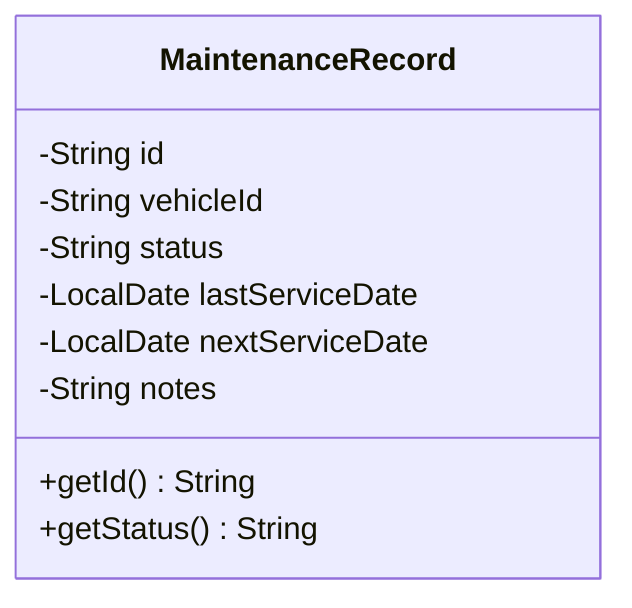

# Component Documentation: Maintenance & Vehicle Availability

* **🎓 Student Identifier:** Student 6
* **🆔 University Registration No.:** IT25100429
* **🌿 Dedicated Git Branch:** `IT25100429---Maintenance-&_Vehicle-Availability`

---

## 1. Subsystem Overview & Purpose
The **Maintenance & Vehicle Availability** component tracks fleet service statuses to guarantee passenger safety. It handles:
* Scheduling, tracking, and logging routine inspections and repairs for all fleet vehicles.
* Managing vehicle availability states using defined status constants (`AVAILABLE`, `IN_USE`, `MAINTENANCE`).
* Restricting reservation requests by blocking booking controllers from selecting vehicles marked under `MAINTENANCE`.
* Managing service records, including last service dates, next service dates, and maintenance notes.

---

## 2. Component Directory & File Mapping
This component's responsibilities are divided across standard Spring Boot MVC tiers:

* **Entities (Domain Entities):**
  * [MaintenanceRecord.java](../src/main/java/com/sliit/vehiclerentalsystem01/maintenance/entity/MaintenanceRecord.java): Domain entity containing details of specific maintenance tasks.
  * [MaintenanceStatus.java](../src/main/java/com/sliit/vehiclerentalsystem01/maintenance/entity/MaintenanceStatus.java): Defines standard status constants (`AVAILABLE`, `IN_USE`, `MAINTENANCE`).
* **Repositories (Data Access Layer):**
  * [MaintenanceRepository.java](../src/main/java/com/sliit/vehiclerentalsystem01/maintenance/repository/MaintenanceRepository.java): Coordinates file database operations, parsing, and serialization of maintenance and fleet status records using a custom pipe-separated format.
* **Services (Business Logic):**
  * [MaintenanceService.java](../src/main/java/com/sliit/vehiclerentalsystem01/maintenance/service/MaintenanceService.java): Core maintenance tracking interface.
  * [MaintenanceServiceImpl.java](../src/main/java/com/sliit/vehiclerentalsystem01/maintenance/service/MaintenanceServiceImpl.java): Enforces status transitions and handles default seeding for fleet availability status checks.
* **Controllers (Request Routers):**
  * [MaintenanceController.java](../src/main/java/com/sliit/vehiclerentalsystem01/maintenance/controller/MaintenanceController.java): Coordinates staff service dashboards and routine checkup log creation routes.
* **Thymeleaf HTML Templates (`templates/user` folder):**
  * `user/maintenance-dashboard.html`: Operational fleet service status boards view.

---

## 3. Academic OOP Rubric Implementation

### A. Abstraction
Isolates complex vehicle availability states behind high-level, cohesive APIs. Client services (such as booking) check availability status without having to parse raw log dates and notes:
```java
public boolean isVehicleAvailableForRental(String vehicleId) {
    Optional<MaintenanceRecord> record = findByVehicleId(vehicleId);
    return record.isPresent() && MaintenanceStatus.AVAILABLE.equals(record.get().getStatus());
}
```

### B. Encapsulation
Keep fields `private`. State variables (such as status updates) are validated against status constants before changes are written:
```java
private static void validateStatus(String status) {
    if (!MaintenanceStatus.AVAILABLE.equals(status)
            && !MaintenanceStatus.IN_USE.equals(status)
            && !MaintenanceStatus.MAINTENANCE.equals(status)) {
        throw new IllegalArgumentException("Invalid maintenance status: " + status);
    }
}
```

### C. Inheritance & Modularity
The maintenance component is designed as an independent, decoupled module. It interfaces with the `vehicle` and `reservation` domains while keeping its database concerns cleanly isolated.



---

## 4. Flat-File Persistence Schema (`data/maintenance.txt`)
Maintenance logs are saved in a pipe-delimited (`|`) format inside `data/maintenance.txt`:
* **Record Schema:**
  `id|vehicleId|status|lastServiceDate|nextServiceDate|notes`
* **Sample Entry:**
  `MNT-001|VEH-101|MAINTENANCE|2026-04-18|2026-05-18|Routine inspection in progress`

### 🛡️ Concurrency Controls & Thread-Safety Model
Because fleet availability states and service windows are vital triggers for scheduling booking checkouts and catalog browsing, [MaintenanceRepository.java](../src/main/java/com/sliit/vehiclerentalsystem01/maintenance/repository/MaintenanceRepository.java) applies robust concurrent locking mechanics:
* **Shared Status Lookups:** Front desk staff checking availability logs or loading vehicle status boards acquire a shared `ReadLock`, permitting fast concurrent read access to status parameters.
* **Atomic Service Scheduling:** Modifying maintenance records, scheduling inspections, or logging repair notes acquires an exclusive `WriteLock`, coordinating file writes in `data/maintenance.txt` atomically.
* **Decoupled Architecture (Single Responsibility Principle):** The service layer ([MaintenanceServiceImpl.java](../src/main/java/com/sliit/vehiclerentalsystem01/maintenance/service/MaintenanceServiceImpl.java)) validates business rules (e.g., verifying that next-service dates reside in the future, transitioning status flags safely). It delegates all direct file serialization and pipe parsing logic to the repository layer, upholding SRP.
* **Fault-Tolerant Scanning:** If a single maintenance log contains corrupted characters or misaligned pipe delimiters, the parser intercepts the exception, logs it as a warning via SLF4J, and returns the valid maintenance logs safely.

---

## 5. Component Workflows

### A. Fleet Maintenance Scheduling Sequence
```text
[Staff Logs Service Entry] ──(HTTP POST /maintenance/log)──> [MaintenanceController]
                                                                    │
                                                         (validates service dates)
                                                                    ▼
     [MaintenanceRepository] <──(call addRecord())── [MaintenanceServiceImpl]
                  │
        (serializes via pipe delimiter)
                  ▼
     (vehicle status set to MAINTENANCE) ──> [Reservation Service blocks bookings]
```

---

## 6. Verification and Integration
The component is verified by:
* Testing availability status transitions on vehicles. Putting a vehicle into `MAINTENANCE` status via staff dashboard routes asserts that it successfully blocks any booking controller attempts.
* Inspecting pipe-separated CSV parsing in `data/maintenance.txt` to confirm that statuses transition correctly to `IN_USE` once rentals start and return to `AVAILABLE` upon completion.
