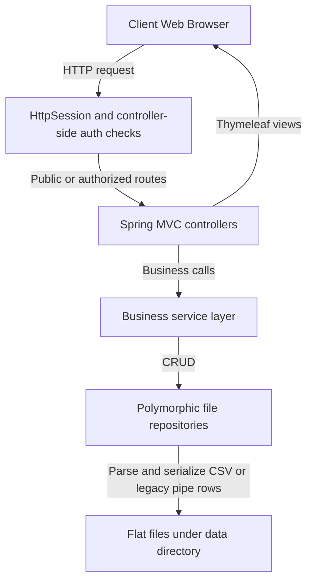

# 🚗 DriveAway: Premium Vehicle Rental & Fleet Management System

An enterprise-grade, lightweight **Vehicle Rental and Fleet Management Platform** built with **Spring Boot 3.4.5**, **Java 17 (language level / bytecode target)**, and **Thymeleaf**. The project is configured for **JDK 17** as the reference toolchain; it can also be run on newer JDKs (for example **JDK 21 or 24**) with the same Maven setup. Designed as an academic-grade project for **SLIIT (Sri Lanka Institute of Information Technology)**, this system showcases layered MVC, servlet-session–based access checks, and a custom **thread-safe flat-file repository layer** that exemplifies I/O streams and the core pillars of Object-Oriented Programming (OOP).

---

## 🏗️ Core System Architecture

The application adopts a decoupled, layered MVC architecture. Rather than relying on a heavy SQL database, the project uses a **flat-file repository layer** where records are saved in canonical delimited flat files under the `data/` directory (path controlled by `app.data.directory`).

To reduce race conditions under concurrent access, **most** repositories use **`java.util.concurrent.locks.ReentrantReadWriteLock`**: shared read locks for queries and exclusive write locks for read-modify-write persistence to disk. (The reviews repository currently uses `Files` read/write without that lock; see [ReviewRepository](../src/main/java/com/sliit/vehiclerentalsystem01/review/repository/ReviewRepository.java).)

### High-Level Data Flow



---

## 🛠️ Technology Stack

* **Language / bytecode:** Java **17** (`java.version` in Maven); run with **JDK 17+** (team may use JDK 21 or 24).
* **Framework:** **Spring Boot 3.4.5** (Spring Web MVC, Spring context, validation).
* **Embedded server:** **Undertow** (`spring-boot-starter-undertow`); default **Tomcat** starter is excluded in `pom.xml`.
* **View engine:** **Thymeleaf 3.1.x** (via Spring Boot BOM), HTML under `src/main/resources/templates/`.
* **Repository layer:** Custom serialization with **`ReentrantReadWriteLock`** on most mutating repositories, **`java.nio.file.Files`**, UTF-8 text, SLF4J logging; tolerant parsing skips bad lines where implemented.
* **Build:** **Apache Maven** (3.9+ recommended).

### 🗄️ Custom Thread-Safe Flat-File Database Engine

Repositories buffer in memory, mutate domain lists, and rewrite whole files (often under a write lock) so readers see consistent snapshots. Malformed lines are typically skipped and logged rather than failing the entire load (behavior is per-repository).

---

## 🎨 Academic OOP Rubric Mapping

This codebase is structured to demonstrate the **four pillars of OOP** in a transparent way.

### 1. Abstraction (Base Contracts)

* [User.java](../src/main/java/com/sliit/vehiclerentalsystem01/user/entity/User.java): Abstraction for authenticated users; contract `getUserRole()`.
* [Vehicle.java](../src/main/java/com/sliit/vehiclerentalsystem01/vehicle/entity/Vehicle.java): `getVehicleType()`, `calculateRentalRate()`, `getSpecificDetail()`, `toCSV()`.
* [Transaction.java](../src/main/java/com/sliit/vehiclerentalsystem01/reservation/entity/Transaction.java): `getTransactionType()`.
* [Payment.java](../src/main/java/com/sliit/vehiclerentalsystem01/payment/entity/Payment.java): `getPaymentMethod()` (and related helpers).
* [Feedback.java](../src/main/java/com/sliit/vehiclerentalsystem01/review/entity/Feedback.java): `getReviewType()`.

### 2. Encapsulation (Access and Domain Integrity)

* Private/protected fields with getters/setters; validation in services (for example overlap checks in [ReservationServiceImpl.java](../src/main/java/com/sliit/vehiclerentalsystem01/reservation/service/ReservationServiceImpl.java)).
* File I/O confined to repository classes.

### 3. Inheritance (Class Hierarchies)

```text
User (Abstract)
 ├── Customer (Concrete)
 └── Staff (Abstract)
      ├── AdminStaff (Concrete)
      └── SupportStaff (Concrete)

Vehicle (Abstract)
 ├── Car (Concrete — seatingCapacity, imagePath)
 └── Motorcycle (Concrete — helmetIncluded, imagePath)

Transaction (Abstract)
 └── Booking (Concrete)

Payment (Abstract)
 ├── CardPayment (Concrete)
 └── CashPayment (Concrete)

Feedback (Abstract)
 └── CustomerReview (Concrete)
```

### 4. Polymorphism (Dynamic Dispatch)

* **`toCSV()` / `toCsvLine()`** on concrete entities for persistence.
* Thymeleaf views call polymorphic getters (`getSpecificDetail()`, `getPaymentMethod()`, etc.).

---

## 🗄️ File Database and Repository Layer Specification

Delimiters are primarily **comma** (`,`) with **legacy pipe** (`|`) support in several parsers.

### Concurrency and Fault Tolerance (Summary)

1. **`ReentrantReadWriteLock`** on **most** repositories that perform file updates (reviews are the notable exception today).
2. **Read-modify-write** of full file content for atomic saves where implemented.
3. **Skip-and-log** for bad lines in parsers that support it (see each repository).

### Canonical Data Schemas (`data/` directory)

| Data File | Delimiter | Record types / prefixes | Schema fields | Description |
| :--- | :---: | :--- | :--- | :--- |
| **[users.txt](../data/users.txt)** | `,` | Customer / Staff rows (no type prefix column) | **Customer (9 fields):** `id,name,email,username,password,nic,license,phone,profilePicture`<br>**Staff (8 fields):** `id,name,email,phone,username,password,role,profilePicture` | [UserRepository](../src/main/java/com/sliit/vehiclerentalsystem01/user/repository/UserRepository.java). Legacy `CUSTOMER\|...` / `STAFF\|...` lines are converted on read paths where applicable. |
| **[vehicles.txt](../data/vehicles.txt)** | `,` | `Car` / `Motorcycle` | **Car:** `Car,id,brand,model,dailyRate,seatingCapacity,imagePath`<br>**Motorcycle:** `Motorcycle,id,brand,model,dailyRate,helmetIncluded,imagePath` | [VehicleRepository](../src/main/java/com/sliit/vehiclerentalsystem01/vehicle/repository/VehicleRepository.java). `imagePath` may be omitted in older rows; parser supplies a default. |
| **[bookings.txt](../data/bookings.txt)** | `,` | — | `transactionId,customerName,rentalDate,vehicleId,durationDays,status,staffMessage` | [ReservationRepository](../src/main/java/com/sliit/vehiclerentalsystem01/reservation/repository/ReservationRepository.java). |
| **[payments.txt](../data/payments.txt)** | `,` | `CARD` / `CASH` | `CARD` or `CASH`, then id, bookingId, amount, status (and card-specific columns per line format) | [PaymentRepository](../src/main/java/com/sliit/vehiclerentalsystem01/payment/repository/PaymentRepository.java). Status strings are normalized in code via [PaymentStatus](../src/main/java/com/sliit/vehiclerentalsystem01/payment/entity/PaymentStatus.java) where used. |
| **[reviews.txt](../data/reviews.txt)** | `,` | — | Base: `reviewId,reviewerName,rating,comments,status,bookingId,vehicleId,staffReply,repliedBy,repliedAt` plus optional **`imageUrl`** as an 11th field | [ReviewRepository](../src/main/java/com/sliit/vehiclerentalsystem01/review/repository/ReviewRepository.java) / [CustomerReview](../src/main/java/com/sliit/vehiclerentalsystem01/review/entity/CustomerReview.java). |
| **[maintenance.txt](../data/maintenance.txt)** | `\|` | — | `id\|vehicleId\|status\|lastServiceDate\|nextServiceDate\|notes` | [MaintenanceRepository](../src/main/java/com/sliit/vehiclerentalsystem01/maintenance/repository/MaintenanceRepository.java). |

> [!IMPORTANT]
> **Legacy pipe formats:** Several repositories still accept older `|`-based lines and normalize toward comma formats on save. Exact legacy shapes are defined in the corresponding repository and entity `fromCsv` / `fromCSV` helpers.

---

## 👥 Student Contributions Table (SLIIT Assignment Rubric)

Six components map to group members. **Per-author commit counts change over time**; use `git shortlog -sn` (or your Git host) for current statistics instead of fixed numbers.

| Student Reg No. | Dedicated Git Branch | Assigned Component | Key responsibilities (summary) |
| :---: | :--- | :--- | :--- |
| **IT25100142** | `IT25100142---User-Management` | **User Management** | User entities, auth controllers, `UserRepository`, `UserServiceImpl`, dashboards, layouts. |
| **IT25100445** | `IT25100445---Reservations-&-Bookings` | **Reservations & Bookings** | `Transaction` / `Booking`, reservation repository and service, booking flows and admin views. |
| **IT24100879** | `IT24100879---Vehicle-Fleet-Inventory` | **Vehicle Fleet Inventory** | Vehicle hierarchy, `VehicleRepository`, fleet UI and admin vehicle management. |
| **IT25100385** | `IT25100385---Payment-&-Billing` | **Payment & Billing** | `CardPayment` / `CashPayment`, payment repository and service, billing and receipts. |
| **IT25100565** | `IT25100565--Customer-Reviews` | **Customer Reviews** | `Feedback` / `CustomerReview`, review repository and service, moderation and replies. |
| **IT25100429** | `IT25100429---Maintenance-&_Vehicle-Availability` | **Maintenance & Vehicle Availability** | `MaintenanceRecord`, maintenance repository and service, fleet maintenance views. |

---

## 🚀 Setup and Running Guide

### Prerequisites

* **JDK:** 17 or newer (project targets Java 17 bytecode).
* **Maven:** 3.9+ on `PATH`, or use the Maven bundled with your IDE.

### 1. Configuration ([application.properties](../src/main/resources/application.properties))

Committed defaults include server port **8081**, Thymeleaf locations, multipart limits, and optional import of a **gitignored** root file for personal overrides:

```properties
spring.application.name=Vehicle Rental System
server.port=8081
spring.thymeleaf.cache=false
spring.thymeleaf.prefix=classpath:/templates/
spring.thymeleaf.suffix=.html
spring.mvc.format.date=iso
spring.mvc.format.date-time=iso
app.data.directory=data
spring.servlet.multipart.max-file-size=2MB
spring.servlet.multipart.max-request-size=2MB
spring.config.import=optional:file:./application-local.properties
```

Create **`application-local.properties`** in the **project root** only on your machine (it is listed in `.gitignore`) to override port or other keys without affecting teammates.

### 2. Build output and Thymeleaf

Spring serves Thymeleaf templates and `application.properties` from the **classpath**, normally `target/classes` after a Maven build. If the IDE runs the app without copying `src/main/resources` into `target/classes`, you may see warnings about missing `classpath:/templates/` and HTTP 500s on view names.

**Recommended:** run **`mvn clean compile`** or **`mvn clean package`** before running, or enable your IDE’s option to **delegate build/run actions to Maven** so resources stay in sync.

### 3. Compile and package

```bash
mvn clean package
```

### 4. Run the application

```bash
mvn spring-boot:run
```

Then open **`http://localhost:8081/`** (or the port set in `application-local.properties` if you override it).

---

## 🔐 Sample users (from repository `data/users.txt`)

The application **does not auto-seed** `users.txt` inside [UserRepository](../src/main/java/com/sliit/vehiclerentalsystem01/user/repository/UserRepository.java). Users and passwords come from whatever is stored in **`data/users.txt`** in your working copy.

The **committed sample file** (as of this documentation refresh) includes for example:

| Role | Example username | Example password | Notes |
| :--- | :--- | :--- | :--- |
| Staff / Admin | `admin` | `admin123` | Row `EMP-01,...` — staff login flow. |
| Staff / Admin | `master1` | `master123` | Row `EMP-MA1,...` — master admin. |
| Customer | `ada` | `pass123` | Row `C-1001,...` — customer portal. |
| Customer | `test1` | *(stored hash)* | Password is a hash string in the sample file; use registration or replace with a known test password for local demos. |

Always treat `data/users.txt` as **environment-specific**: your team may replace rows for coursework or demos. Staff sign-in uses **`/auth/staff-login`**; customers use **`/auth/login`** (see [UserAuthController](../src/main/java/com/sliit/vehiclerentalsystem01/user/controller/UserAuthController.java)).

---

## 🧪 Testing and Verification

```bash
mvn test
```

The project includes `spring-boot-starter-test` for unit and integration style tests under `src/test/java` (extend as needed).
