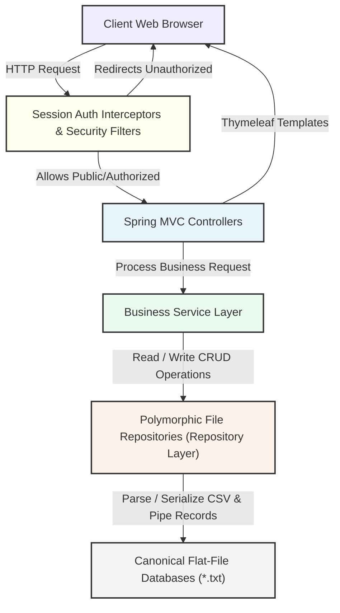

# 🚗 DriveAway: Premium Vehicle Rental & Fleet Management System

An enterprise-grade, lightweight **Vehicle Rental and Fleet Management Platform** built with **Spring Boot 3.x**, **Java 17**, and **Thymeleaf**. Designed as an academic-grade project for **SLIIT (Sri Lanka Institute of Information Technology)**, this system showcases robust architectural patterns, non-blocking page controls, and a custom-built, thread-safe **Flat-File Database Repository Layer** that exemplifies advanced I/O streams and the core pillars of Object-Oriented Programming (OOP).

---

## 🏗️ Core System Architecture

The application adopts a decoupled, layered MVC architecture. Rather than relying on a heavy SQL database, the project utilizes a lightweight **Flat-File Repository Layer** where records are saved in canonical delimited flat-files inside the `data/` directory.

### High-Level Data Flow



---

## 🛠️ Technology Stack

* **Core Language:** Java 17
* **Framework:** Spring Boot 3.x (Spring Web, Starter Thymeleaf, Servlet Session handling)
* **View Engine:** Thymeleaf 3.x (Styled with premium modern CSS, responsive grids, and luxury dynamic dashboards)
* **Repository Layer:** Custom Object-to-Flat-File serialization system using Java I/O Streams (`BufferedReader`/`BufferedWriter` and `java.nio.file.Files`) inside Repository components.
* **Build System:** Apache Maven 3.9+

---

## 🎨 Academic OOP Rubric Mapping

This codebase is specifically engineered to demonstrate the **Four Pillars of Object-Oriented Programming (OOP)** in a highly transparent, rigorous, and academically sound manner:

### 1. Abstraction (Base Contracts)
The system isolates complex subsystems by defining abstract classes with polymorphic method contracts. Client modules interact with high-level abstractions without knowing the underlying concrete classes:
* [User.java](file:///c:/Users/chamidu/Desktop/new%20oop/VehicleRentalSystem01/src/main/java/com/sliit/vehiclerentalsystem01/user/entity/User.java): The high-level abstraction for all authenticated users. It defines core properties (`id`, `name`, `email`) and exposes the abstract contract `getUserRole()`.
* [Vehicle.java](file:///c:/Users/chamidu/Desktop/new%20oop/VehicleRentalSystem01/src/main/java/com/sliit/vehiclerentalsystem01/vehicle/entity/Vehicle.java): Declares abstract contracts `getVehicleType()`, `calculateRentalRate()`, `getSpecificDetail()`, and `toCSV()`.
* [Transaction.java](file:///c:/Users/chamidu/Desktop/new%20oop/VehicleRentalSystem01/src/main/java/com/sliit/vehiclerentalsystem01/reservation/entity/Transaction.java): Exposes the abstract contract `getTransactionType()` to represent transactional records.
* [Payment.java](file:///c:/Users/chamidu/Desktop/new%20oop/VehicleRentalSystem01/src/main/java/com/sliit/vehiclerentalsystem01/payment/entity/Payment.java): Declares the abstract method `getPaymentMethod()` to encapsulate multiple transactional ledger flows.
* [Feedback.java](file:///c:/Users/chamidu/Desktop/new%20oop/VehicleRentalSystem01/src/main/java/com/sliit/vehiclerentalsystem01/review/entity/Feedback.java): Declares the abstract method `getReviewType()` to support polymorphic display layouts.

### 2. Encapsulation (Access & Domain Integrity)
* **State Protection:** All fields in the entity/model classes are declared `private` or `protected`. State transitions are strictly controlled via public getter and setter methods.
* **Domain Validation:** Setters and services enforce business boundaries. For example, [ReservationServiceImpl.java](file:///c:/Users/chamidu/Desktop/new%20oop/VehicleRentalSystem01/src/main/java/com/sliit/vehiclerentalsystem01/reservation/service/ReservationServiceImpl.java) contains temporal logic and overlap checks to prevent temporal and double-booking conflicts.
* **Deletion Protection:** Deletions are guarded with transactional integrity. The services ensure that a customer cannot be deleted if they have active rentals, and vehicles under active bookings cannot be removed from the fleet.
* **Self-Contained File Parsing:** All file I/O operations are strictly encapsulated inside the respective repository layers (`UserRepository`, `VehicleRepository`, etc.). Controllers and Services never manipulate the underlying raw files directly.

### 3. Inheritance (Class Hierarchies)
The project demonstrates clean, deep subclass hierarchies to maximize code reuse, domain separation, and logical organization:
```text
User (Abstract)
 ├── Customer (Concrete)
 └── Staff (Abstract)
      ├── AdminStaff (Concrete)
      └── SupportStaff (Concrete)

Vehicle (Abstract)
 ├── Car (Concrete - encapsulates seatingCapacity)
 └── Motorcycle (Concrete - encapsulates helmetIncluded flag)

Transaction (Abstract)
 └── Booking (Concrete - captures vehicleId, rentalDate, durationDays, and status)

Payment (Abstract)
 ├── CardPayment (Concrete - Credit/Debit processing)
 └── CashPayment (Concrete - Cash tender and ledger tracking)

Feedback (Abstract)
 └── CustomerReview (Concrete - encapsulates star rating, comments, status, and staff reply trails)
```

### 4. Polymorphism (Dynamic Dispatch)
* **Polymorphic Serialization:** Overriding `toCSV()` (or `toCsvLine()`) enables writing domain objects directly to flat-files. The application calls `toCSV()` on a list of `Vehicle` objects, and JVM's dynamic dispatch serializes `Car` and `Motorcycle` instances with their specific fields natively.
* **Polymorphic UI Rendering:** When rendering HTML pages via Thymeleaf, the template invokes high-level getters (e.g. `vehicle.getSpecificDetail()`, `payment.getPaymentMethod()`, `user.getUserRole()`). The JVM dynamically dispatches to the correct subclass method at runtime, ensuring distinct vehicle types display custom properties.
* **Polymorphic Action Handlers:** Methods accept base abstraction types (e.g., saving a `User` or `Vehicle`), dynamically invoking overridden methods corresponding to the concrete subtype subclass.

---

## 🗄️ File Database & Repository Layer Specification

The custom repository engine parses and serializes domain objects using structured delimiters. The database maintains transactional state through comma-delimited (`,`) and pipe-delimited (`|`) text files.

### Canonical Data Schemas (`data/` directory)

| Data File | Delimiter | Record Types / Prefixes | Schema Fields | Description |
| :--- | :---: | :--- | :--- | :--- |
| **[users.txt](file:///c:/Users/chamidu/Desktop/new%20oop/VehicleRentalSystem01/data/users.txt)** | `,` | `Customer` / `Staff` | **Customer (8 fields):** `id,name,email,username,password,nic,license,phone`<br>**Staff (7 fields):** `id,name,email,phone,username,password,role` | Managed by `UserRepository`. Stores credentials, user profiles, and active access roles. Role defaults to `Support` or `Admin`. |
| **[vehicles.txt](file:///c:/Users/chamidu/Desktop/new%20oop/VehicleRentalSystem01/data/vehicles.txt)** | `,` | `Car` / `Motorcycle` | **Car:** `Car,id,brand,model,dailyRate,seatingCapacity`<br>**Motorcycle:** `Motorcycle,id,brand,model,dailyRate,helmetIncluded` | Managed by `VehicleRepository`. Tracks vehicle fleet. First column acts as the polymorphic discriminator. |
| **[bookings.txt](file:///c:/Users/chamidu/Desktop/new%20oop/VehicleRentalSystem01/data/bookings.txt)** | `,` | *None* | `transactionId,customerName,rentalDate,vehicleId,durationDays,status,staffMessage` | Managed by `ReservationRepository`. Maintains active bookings. Connects customers to vehicles with date boundaries. |
| **[payments.txt](file:///c:/Users/chamidu/Desktop/new%20oop/VehicleRentalSystem01/data/payments.txt)** | `,` | `CARD` / `CASH` | `CARD/CASH,id,bookingId,amount,status` | Managed by `PaymentRepository`. Financial records ledger tracking invoice payment totals and statuses. |
| **[reviews.txt](file:///c:/Users/chamidu/Desktop/new%20oop/VehicleRentalSystem01/data/reviews.txt)** | `,` | *None* | `reviewId,reviewerName,rating,comments,status,bookingId,vehicleId,staffReply,repliedBy,repliedAt` | Managed by `ReviewRepository`. Keeps user reviews, star ratings, and administrator feedback loops. |
| **[maintenance.txt](file:///c:/Users/chamidu/Desktop/new%20oop/VehicleRentalSystem01/data/maintenance.txt)** | `\|` | *None* | `id\|vehicleId\|status\|lastServiceDate\|nextServiceDate\|notes` | Managed by `MaintenanceRepository`. Stores vehicle logs. Interacts with vehicle service to restrict double booking of vehicles in maintenance. |

> [!IMPORTANT]
> **Polymorphic CSV Discriminators & Backward Compatibility:**
> The `*Repository` layers implement smart parsers that support backward compatibility. When the parser encounters a line containing pipe (`|`) boundaries in legacy files (e.g. legacy `DAILY\|...` bookings or `CUSTOMER\|...` users), it seamlessly routes parsing to dedicated polymorphic legacy converters, updating them on the subsequent save to modern, uniform comma-separated formats.

---

## 👥 Student Contributions Table (SLIIT Assignment Rubric)

Six distinct components were assigned to student group members, ensuring modular separation of concerns and individual code-level ownership:

| Student Reg No. | Dedicated Git Branch | Assigned Component | Key Responsibilities & Implementations | Commit Contribution |
| :---: | :--- | :--- | :--- | :---: |
| **IT25100142** | `IT25100142---User-Management` | **User Management** | **Lead Developer / Core Integrator.** Developed the base abstractions and entities for users (`User`, `Customer`, `Staff`), password hashing, the Unified Session Auth rules ([UserAuthController.java](file:///c:/Users/chamidu/Desktop/new%20oop/VehicleRentalSystem01/src/main/java/com/sliit/vehiclerentalsystem01/user/controller/UserAuthController.java)), the primary `UserRepository.java` and `UserServiceImpl.java`, dynamic dashboard routing, and general layouts. | **106 Commits** |
| **IT25100445** | `IT25100445---Reservations-&-Bookings` | **Reservations & Bookings** | Developed the transaction entity layers (`Transaction`, `Booking`), built the `ReservationRepository.java` and `ReservationServiceImpl.java`, dynamic date conflict prevention, vehicle availability validations, booking request panels, and active rental status managers. | **29 Commits** |
| **IT24100879** | `IT24100879---Vehicle-Fleet-Inventory` | **Vehicle Fleet Inventory** | Created polymorphic vehicle hierarchies (`Vehicle`, `Car`, `Motorcycle`), built `VehicleRepository.java` and `VehicleServiceImpl.java`, the admin vehicle configuration forms, vehicle listing preview cards, dynamic catalog page, and vehicle usage check filters. | **31 Commits** |
| **IT25100385** | `IT25100385---Payment-&-Billing` | **Payment & Billing** | Developed the polymorphic payment structures (`CardPayment`, `CashPayment`), billing calculator logic based on duration, `PaymentRepository.java` and `PaymentServiceImpl.java` ledgers, credit card verification flows, and printable receipts. | **14 Commits** |
| **IT25100565** | `IT25100565--Customer-Reviews` | **Customer Reviews** | Developed reviews inheritance system (`Feedback` abstract base class with concrete `CustomerReview` subclass), `ReviewRepository.java` and `ReviewServiceImpl.java`, star rating controls, reviewer verification rules, and staff response panels. | **33 Commits** |
| **IT25100429** | `IT25100429---Maintenance-&_Vehicle-Availability` | **Maintenance & Vehicle Availability** | Built the administrative maintenance record tracking engine (`MaintenanceRecord`, `MaintenanceStatus`), `MaintenanceRepository.java` and `MaintenanceServiceImpl.java`, status logs (`AVAILABLE`, `IN_USE`, `MAINTENANCE`), next-service date validators, and staff directories. | **15 Commits** |

---

## 🚀 Setup & Running Guide

Follow these instructions to configure and execute the application locally.

### Prerequisites
* **Java Development Kit (JDK):** Version 17+
* **Apache Maven:** Version 3.9+

### 1. Configure the Data Storage Location
Configure the persistent flat-file directory in [src/main/resources/application.properties](file:///c:/Users/chamidu/Desktop/new%20oop/VehicleRentalSystem01/src/main/resources/application.properties):
```properties
# Canonical data storage directory (defaults to 'data' in the project root)
app.data.directory=data
server.port=8080
```

### 2. Compile & Package the Project
Compile the Java source files and package them into a runnable jar:
```bash
mvn clean package
```

### 3. Run the Spring Boot Application
Launch the dev web server:
```bash
mvn spring-boot:run
```
Once started, open your browser and navigate to: **`http://localhost:8080/`**

### 4. Admin Seeding & Test Credentials
On initial system boot, `UserRepository` detects if `data/users.txt` is empty or missing, seeding default credentials for demonstration and grading purposes:

* **Master Administrator Profile:**
  * **Username:** `admin` (or Email: `admin@driveaway.com`)
  * **Password:** `admin123`
  * **Permissions:** Access to user management, staff registry, vehicle registration, and payments console.
* **Customer Profile:**
  * **Username:** `customer` (or Email: `customer@gmail.com`)
  * **Password:** `customer123`
  * **Permissions:** Browse available vehicles, place active bookings, make payments, and write ratings/reviews.
* **Support / Maintenance Staff Profile:**
  * **Username:** `support` (or Email: `support@driveaway.com`)
  * **Password:** `support123`
  * **Permissions:** Log vehicle maintenance entries, edit fleet schedules, and respond to reviews.

---

## 🧪 Testing and Verification

The repository is configured to support automated unit testing modules that assert correct flat-file serialization, temporal date validations, and polymorphic dispatch configurations using Spring Boot's test framework.

* **To compile and test:**
  ```bash
  mvn test
  ```
